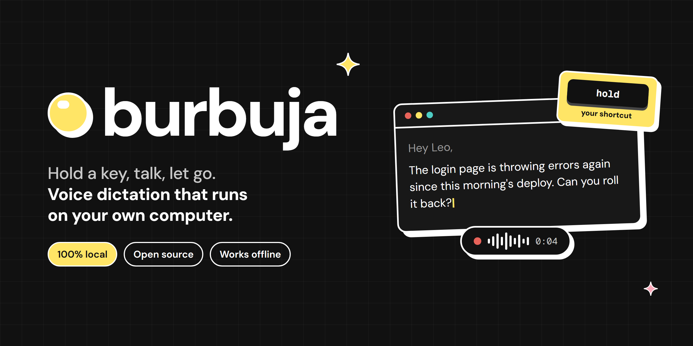
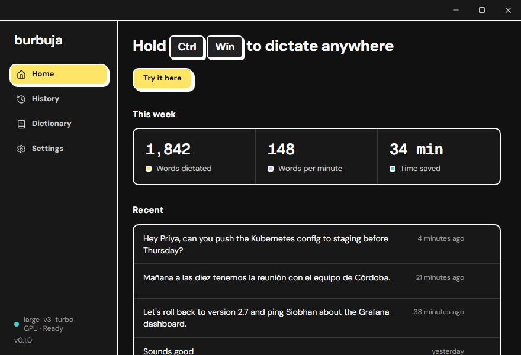

<p align="center">
  
</p>

<p align="center">
  <a href="LICENSE"></a>
  
  
  <a href="#how-this-was-built"></a>
</p>

**Burbuja** is system-wide voice dictation that runs entirely on your computer. Hold your shortcut, say what you want to write, let go: the text appears wherever your cursor is, in under half a second.

## Features

- **Fully local.** Speech recognition runs on your machine, on the GPU through Vulkan or on the CPU. There are no accounts, no telemetry and no cloud services; the only network request is the speech model download you start yourself.
- **Works in any app.** Email, chat, your editor, the browser. Burbuja inserts the text at the cursor and can keep it out of your clipboard history.
- **Hold or hands-free.** Hold the shortcut to dictate, double-tap it to keep talking for up to five minutes, press Esc to cancel. A small bubble shows what's happening without ever taking focus.
- **Optional AI cleanup.** Connect a local model through [Ollama](https://ollama.com) or [LM Studio](https://lmstudio.ai) to remove filler words and fix punctuation, in a style you pick (formal, casual, excited) or with your own prompt.
- **Your words, your rules.** A dictionary for names and jargon, automatic replacements, and a local history you can search and erase.
- **English and Spanish interface.** The default model understands 99 languages and detects which one you speak.

<p align="center">
  
</p>

## Download

Get the installer from the **[latest release](https://github.com/SantiagoBobrik/burbuja/releases/latest)**:

- **Windows 10 / 11, 64-bit:** `Burbuja_<version>_x64-setup.exe`
- **macOS 11 or later on Apple Silicon:** `Burbuja_<version>_aarch64.dmg` (preview, not yet tested on a real Mac)

The installers aren't code-signed yet, so Windows and macOS warn you the first time you open Burbuja. [Installing Burbuja](docs/INSTALL.md) shows how to get past each warning and how to check that your download is the one published.

On first launch, onboarding asks for the permissions it needs, lets you pick a microphone and downloads a speech model (about 600 MB for the recommended one).

### Build from source

See [docs/BUILDING.md](docs/BUILDING.md) for the toolchain, then:

```sh
git clone --recursive https://github.com/SantiagoBobrik/burbuja.git
cd burbuja
pnpm install
pnpm tauri dev
```

## Speech models

| Model | Size | Best for |
|---|---|---|
| Whisper large-v3-turbo | 620 MB | Accuracy in 99 languages (recommended, needs a GPU) |
| Parakeet TDT 0.6B v3 | 550 MB | Fast transcription on the CPU, 25 European languages |
| Whisper base.en | 64 MB | Low-end machines, English only |

Models are downloaded over HTTPS, pinned to an exact version and verified with SHA-256 before use.

## Privacy

Your voice never leaves your computer. Audio is processed in memory and discarded unless you turn on "Keep audio". History lives in a local database, and deleting it erases it from disk. AI cleanup only connects to a server on your own machine (`localhost`). See [SECURITY.md](SECURITY.md) for how to report a vulnerability.

## How this was built

Burbuja is a vibe-coded app: almost all of its code was written by AI coding agents. The human work went into the product: deciding what it should do and what it should refuse to do, how it should feel, which trade-offs to make, and testing it every day.

Those product decisions are the backbone of the project: it runs fully on your computer, it inserts text in under half a second, and it never takes focus away from the app you're typing in. The code behind them is held to the same bar as any other: unit tests, strict linters, a dependency license and advisory check, and a security review.

## Contributing

Bug reports and pull requests are welcome. Read [CONTRIBUTING.md](CONTRIBUTING.md) before you start.

## License

Burbuja is released under the [MIT License](LICENSE). Third-party components and their licenses are listed in [THIRD_PARTY_NOTICES.md](THIRD_PARTY_NOTICES.md).
